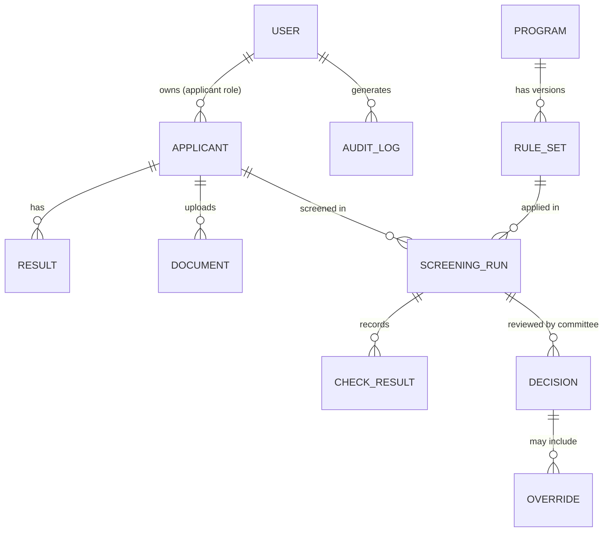

# Data Model (draft)

Draft entities for PostgreSQL. To be refined once the university's real requirements and data formats are known.

## Entities

| Entity | Purpose | Key fields (draft) |
| --- | --- | --- |
| `users` | Accounts and roles | id, role, email, created_at |
| `applicants` | Applicant profile | id, user_id, intake, level (undergraduate / diploma / certificate) |
| `results` | Subject grades | applicant_id, exam (UCE / UACE), subject, grade, source (entered / extracted) |
| `documents` | Uploaded files | applicant_id, type, status, extraction_confidence, review_status |
| `programs` | Programs offered | id, name, level, faculty |
| `rule_sets` | Versioned program rules | program_id, version, effective_from, rules (JSON), documents_required (JSON) |
| `screening_runs` | One screening of one applicant for one program | applicant_id, program_id, rule_set_version, outcome, input_snapshot, run_at |
| `check_results` | Trace of each rule check | run_id, rule_id, passed, expected, actual, gap |
| `recommendations` | Matcher output | run_id, program_id, rank, score, near_miss, pathway |
| `advisory_outputs` | ML output (never used for eligibility) | run_id, kind (progress / anomaly), value, explanation, model_version |
| `decisions` | Committee decision | run_id, decided_by, decision, decided_at |
| `overrides` | Override of a system outcome | decision_id, reason (required), by, at |
| `notifications` | Messages to applicants | applicant_id, kind, sent_at |
| `audit_log` | Append-only action log | actor, action, entity, before, after, at |

## Design notes

- `screening_runs.input_snapshot` stores exactly what the engine saw, so any decision can be reproduced.
- **Protected attributes** (gender, region, school, family income) are stored separately from model features and used only for fairness testing, never as model inputs.
- `audit_log` is append-only.
- Apply retention limits and encryption in line with [ETHICS_AND_PRIVACY.md](ETHICS_AND_PRIVACY.md).

## Rule provenance (added)

`rule_sets` gains these fields:

| Field | Purpose |
| --- | --- |
| `status` | `official`, `adopted-proxy` or `assumed` |
| `source` | Citation of the document the rules came from |
| `edition` | Intake year the source applies to (for example 2026/2027) |
| `approval` | Who approved it and when, or `pending` |

New table `programme_rule_mappings`: `umu_programme_id`, `rule_set_id`, `role` (primary or alternate), `match` (exact, close or partial), `confirmed_by`, `confirmed_at`. A mapping is only treated as confirmed once UMU has signed it off.
